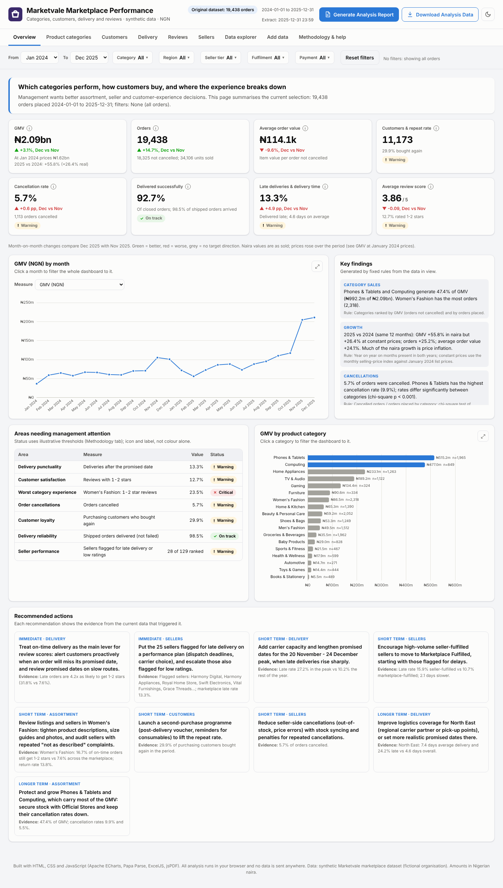
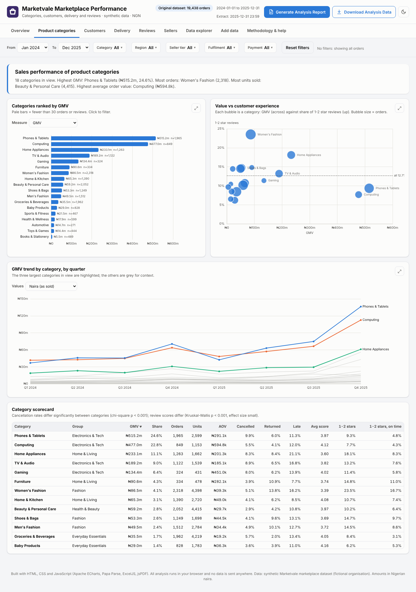
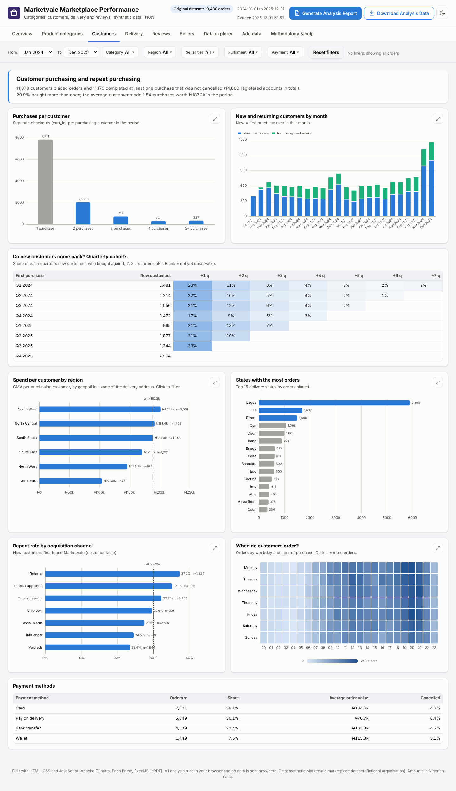
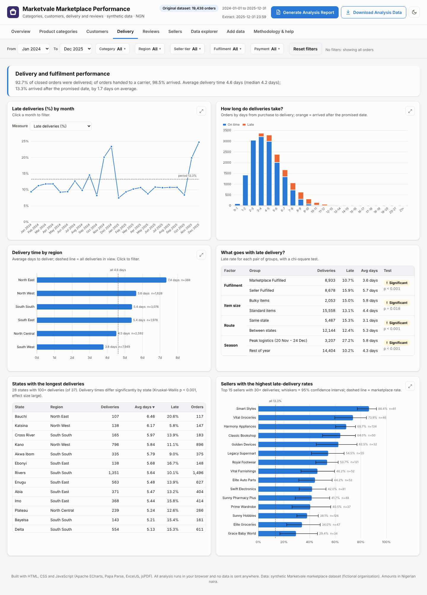
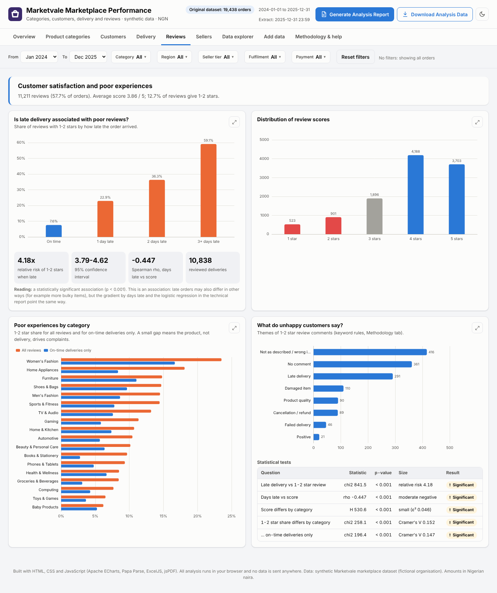
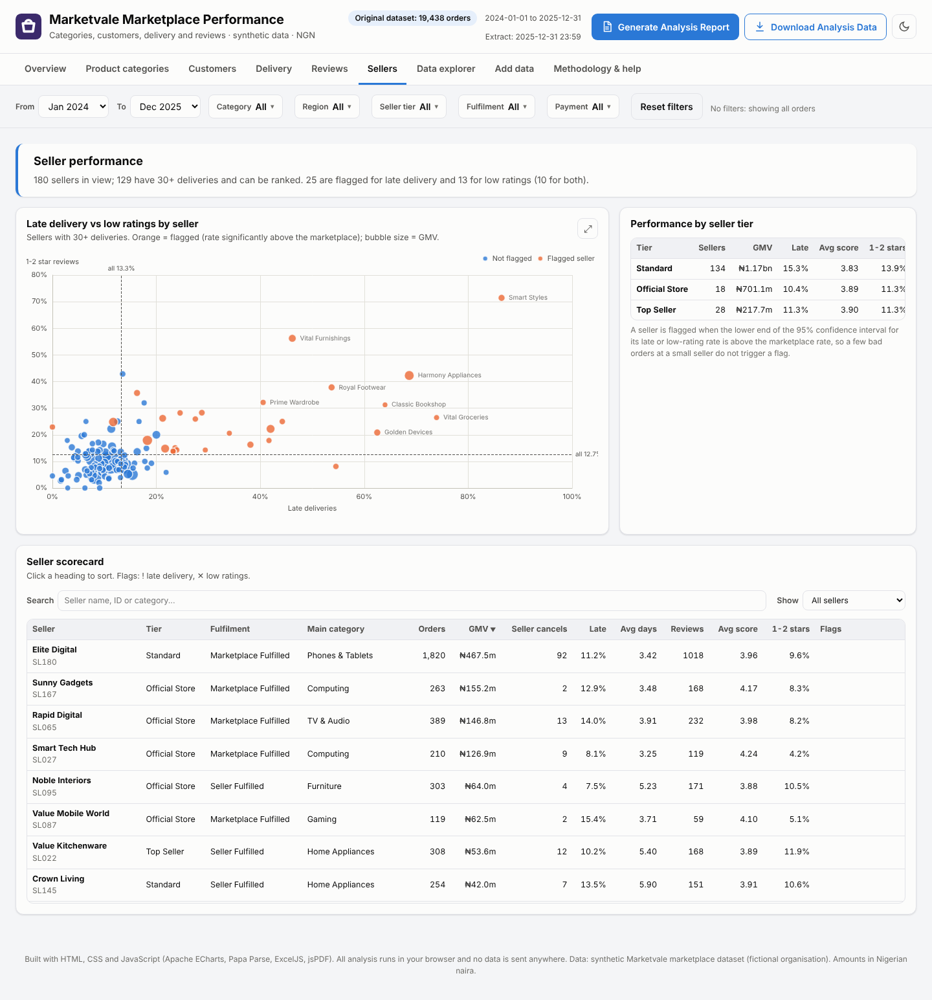
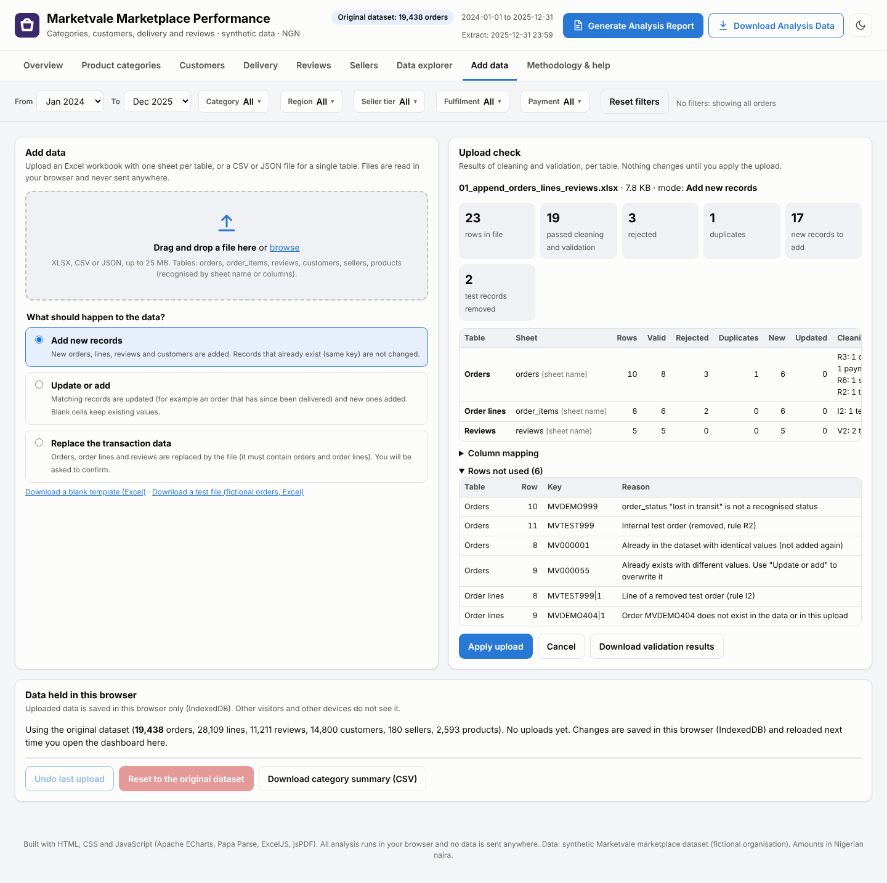
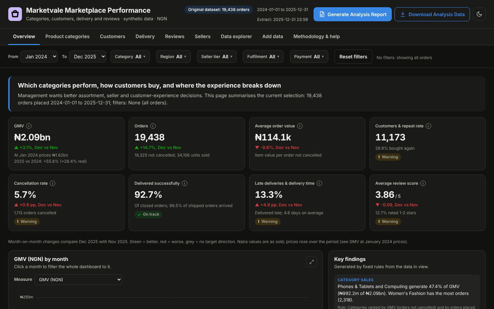
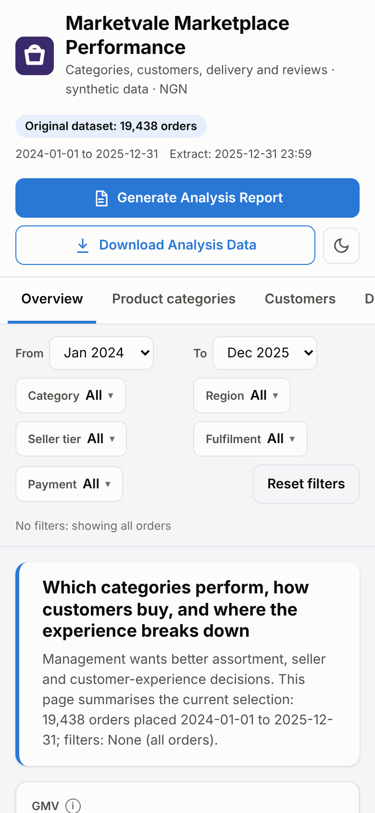

# Marketvale Marketplace Performance Dashboard: Categories, Customers, Delivery and Reviews

An interactive, browser-based analytics dashboard for an online marketplace. It answers four questions for management:
- which product categories perform;
- how customers buy and come back;
- how reliable delivery is;
- what causes poor reviews.

From those answers it produces evidence-backed recommendations on assortment, seller performance and customer experience. Every number is calculated live from the data. Users can add new orders, lines, reviews and other tables, and the whole analysis (including a downloadable PDF report and data export) updates immediately.

> **Synthetic-data disclaimer.** Marketvale is a fictional marketplace. The dataset was generated to simulate a plausible Nigerian e-commerce business; it does not describe the customers, sellers, products or orders of any real organisation. Findings demonstrate the analytical method and are not evidence about real markets. Amounts are in Nigerian naira (NGN).



## 1. Project overview

The project turns a six-table marketplace dataset into a decision-support tool:
- KPI cards with month-on-month change and status;
- category, customer, delivery, review and seller analysis;
- statistical tests that separate delivery problems from product problems;
- rule-based key findings and recommendations, each with its evidence.

The data is first **rebuilt from the raw exports** with 23 coded cleaning rules and reconciled with the published clean tables. The same rules clean every file a user uploads. The dashboard runs entirely in the browser, can be hosted free on GitHub Pages, and also works when opened straight from a folder.

## 2. Business scenario

A Product and Commercial Analyst works with an online marketplace. Management wants to:
- identify which product categories perform best;
- understand customer purchasing behaviour;
- evaluate delivery performance;
- investigate the factors associated with poor customer reviews.

The goal is better product assortment, seller performance and customer experience decisions.

## 3. Business problem

Several questions are open, and the evidence for answering them is scattered across six tables:
- **Reviews:** do low ratings come from the products, the sellers or the delivery?
- **Categories:** which categories carry the business, and which ones disappoint customers?
- **Customers:** do customers come back?
- **Growth:** is it real, or is it inflation?
- **Accountability:** which sellers and regions need intervention?

Answering these needs a consistent, tested set of measures in a tool management can keep using.

## 4. Objectives

1. Evaluate the sales performance of different product categories.
2. Examine customer purchasing and repeat purchasing patterns.
3. Evaluate delivery and fulfilment performance.
4. Analyse customer satisfaction through reviews.
5. Identify product categories associated with poor customer experiences.
6. Develop recommendations to improve marketplace performance.

| Question group | Questions answered | Where |
|---|---|---|
| Product performance | GMV, order volume, item sales, average order value and cancellation rate by category | Product categories tab; Overview |
| Customer behaviour | Unique customers, repeat-purchase rate, spend by location, order volume by area, change over time | Customers tab |
| Customer experience | Average score, lowest-rated categories, delays vs poor reviews, low-rating frequency by category, satisfaction by seller | Reviews and Sellers tabs |
| Delivery and fulfilment | Delivered %, average delivery time, late %, slowest states and regions, sellers with most delays | Delivery and Sellers tabs |

*(The brief's question list also contained a few lines from an Emergency Department project, "Patient flow" and "Waiting time". These were treated as a copy-paste slip and not implemented.)*

## 5. Tools and technologies

| Tool | Version | Used for |
|---|---|---|
| HTML5, CSS3, JavaScript (no framework) | - | Application, design system (light/dark), data processing, statistics |
| [Apache ECharts](https://echarts.apache.org/) | 6.1.0 | Charts |
| [Papa Parse](https://www.papaparse.com/) | 5.4.1 | Reading CSV |
| [ExcelJS](https://github.com/exceljs/exceljs) | 4.4.0 | Reading and writing Excel workbooks |
| [jsPDF](https://github.com/parallax/jsPDF) + AutoTable | 4.2.1 / 5.0.9 | PDF report in the browser |
| IndexedDB | built in | Saving uploaded data locally |
| Python: pandas, NumPy, SciPy, statsmodels | - | Cleaning rebuild, reference analysis, logistic regression |
| Playwright | 1.63.0 | Automated end-to-end tests |

The libraries are stored in `assets/vendor/` (versions and licences in `VERSIONS.txt`), so the page makes no external requests. The statistical tests (chi-square, Kruskal-Wallis, Spearman, relative risk, Wilson intervals) are implemented in `assets/js/utils.js` and verified against SciPy.

## 6. Dataset overview

| Table | Rows | Content |
|---|---:|---|
| orders | 19,438 | One order per seller per checkout: dates, payment, amounts, status, delivery milestones, states |
| order_items | 28,109 | Product lines: quantity, price, discount, line total |
| reviews | 11,211 | 1-5 star review per order, with an optional comment |
| customers | 14,800 | Accounts (3,127 never ordered): signup, state, acquisition channel |
| sellers / products | 180 / 2,593 | Seller tier and fulfilment model; product category, list price, bulky flag |
| categories / states / calendar | 18 / 37 / 731 | Reference tables: 6 category groups, geopolitical zones, sales events and the peak-logistics period |

- **Period:** orders placed 1 Jan 2024 - 31 Dec 2025, extracted at 31 Dec 2025 23:59.
- **Personal data:** none (IDs only, fictional shop names).
- **Raw data:** the source workbook also holds raw exports with documented problems: duplicates, test orders, label variants, kobo prices, text scores and more.

Field definitions: [`data/data-dictionary.md`](data/data-dictionary.md).

## 7. Dashboard features

- **Overview:**
  - 8 KPI cards (GMV, orders, average order value, customers and repeat rate, cancellation rate, delivered %, late deliveries, average review score), with month-on-month change and status;
  - monthly trend with 11 selectable measures, including GMV at constant prices;
  - rule-based key findings and an "areas needing management attention" table;
  - GMV by category and recommended actions.
- **Product categories:** ranking by 10 selectable measures; value vs customer-experience matrix; quarterly GMV trend (naira or constant prices); sortable scorecard with tests.
- **Customers:**
  - purchases per customer; new vs returning customers by month; quarterly cohort table;
  - spend per customer by region; top states; repeat rate by acquisition channel;
  - order-time heatmap; payment methods.
- **Delivery:** late rate, delivery time or success by month; delivery-time distribution; region comparison; factors behind lateness (fulfilment, item size, route, season) with tests; slowest states; sellers with most delays, with confidence intervals.
- **Reviews:** 1-2 star share by days late; score distribution; poor reviews by category (all vs on-time only); complaint themes; statistical tests.
- **Sellers:** late-delivery vs low-rating scatter with flags; tier comparison; searchable scorecard.
- **Data explorer:** every order, with search, sort, column sets and paging.
- **Add data:** multi-table upload with per-table cleaning and validation report; upload history; undo and reset.
- **Methodology & help:** KPI definitions, cleaning rules, analysis rules, upload format.

## 8. How the dashboard works

1. **Loading.** The clean tables are embedded in `data/base-data.js` and read through the same pipeline as any upload.
2. **Order table.** `derive()` joins the six tables into one order-level table: category, seller attributes, region, GMV, delivery days, late flag, review score, comment theme and more.
3. **Analysis.** Filters select the orders. `analyse()` then computes, from those orders:
   - KPIs, monthly and year-on-year comparisons, and constant-price GMV;
   - category, region, state and seller summaries, and customer cohorts;
   - statistical tests;
   - the attention table, findings and recommendations.
4. **Display.** Tabs, the report and exports all read that one analysis context, so they always agree. Only the visible tab is drawn.

## 9. Interactive functionality

- Filters for month range, category, region, seller tier, fulfilment model and payment method. Active filters appear as removable chips.
- Click a month, category or region in a chart to filter the whole dashboard. Measure selectors switch the monthly trend, category ranking and delivery trend.
- Tooltips give exact values, sample sizes and confidence intervals. Every chart has a full-screen view.
- Tables can be sorted; the seller search can show flagged sellers only.
- Keyboard navigation (arrow keys between tabs, Enter to sort), text alternatives for charts, and status shown with icon and label.

## 10. Additional data upload process

1. Open **Add data** and choose a mode:
   - **Add new records:** new records only.
   - **Update or add:** matching records are updated, for example an order that has since been delivered. Blank cells keep existing values.
   - **Replace the transaction data:** orders, lines and reviews are replaced after you confirm.
2. Drop a file (up to 25 MB):
   - an **Excel workbook** with one sheet per table (`orders`, `order_items`, `reviews`, `customers`, `sellers`, `products`, or `raw_...` versions);
   - or a **CSV** or **JSON** file. A JSON file may hold several tables.
3. The file is read **in the browser**:
   - Sheets are recognised by name or columns, and column names are matched (alternative names such as "Order Date" or "Qty" are recognised).
   - The workbook's 23 cleaning rules are applied: test orders, duplicates, day-first dates, label variants, kobo prices, text scores, older review versions and more.
   - References are checked: order lines and reviews need an existing order.
4. The **Upload check** shows, per table:
   - rows, valid, rejected, duplicates, new and updated;
   - the cleaning rules applied and the column mapping;
   - the reason for every row not used, downloadable as CSV.

   Nothing changes until you click **Apply upload**.
5. A confirmation states the actual result, for example: *"Data successfully added. 23 records were processed, 17 were accepted (17 added), 1 duplicate was detected and 5 records were rejected."*

Use the blank template or the fictional test workbook linked on the Add data tab to try it. Uploading the source workbook's raw sheets in replace mode reproduces the clean data exactly.

## 11. Automatic refresh and data persistence

- After an upload, undo or reset, everything is recalculated: every KPI, chart, table, filter option (new months and categories appear), insight, the report and the exports.
- The working dataset and upload history are saved in **this browser's IndexedDB** and restored on the next visit. **They are not visible to other visitors or on other devices.** Nothing is sent to a server.
- **Undo last upload** works for the last 3 uploads. **Reset to the original dataset** clears all local data.

## 12. Analysis performed

- **Category performance:** GMV, share, orders, units, average order value, cancellation, return, late and low-rating rates; quarterly trends in naira and constant prices; chi-square test of cancellations.
- **Customer behaviour:** purchases per checkout, repeat rate, new vs returning customers, quarterly cohort retention, spend per customer by region and state, repeat rate by acquisition channel, order timing, payment methods.
- **Delivery:** delivered and delivery-success rates, delivery time and late rate by month, region, state and seller; fulfilment model, item size, route and peak season, each tested with chi-square.
- **Customer experience:**
  - relative risk of a 1-2 star review when late, and the dose-response by days late (Spearman);
  - score differences by category (Kruskal-Wallis);
  - low-rating share by category, all reviews vs on-time only;
  - complaint themes from comments;
  - seller flags using 95% Wilson intervals.
- **Offline (technical report):** a logistic regression of low ratings on lateness, category, item size, route and fulfilment model.

Details: [`documentation/methodology.md`](documentation/methodology.md).

## 13. Key findings (original dataset)

**Categories**
- **GMV is concentrated.** GMV totals ₦2.09bn from 19,438 orders. Phones & Tablets and Computing generate 47% of it. Women's Fashion has the most orders (2,318), and Beauty & Personal Care sells the most units (4,415).
- **Inflation flatters growth.** 2025 GMV was +55.8% on 2024 in naira but only +26.4% at constant prices. Orders grew 25.2%, and prices rose about 49% over the two years.
- **Cancellations differ by category.** Overall 5.7% of orders are cancelled; Phones & Tablets is highest at 9.9% (chi-square p < 0.001).

**Customers**
- **About 3 in 10 customers return.** 29.9% of 11,173 purchasing customers bought more than once, and about 21% of each quarter's new customers bought again the next quarter. Referral customers repeat most (37%); paid-ads customers least (23%).

**Delivery**
- **Delivery is reliable but often late.** 98.5% of shipped orders arrived, with an average delivery time of 4.6 days. However, 13.3% arrived after the promised date.
- **Late risk is concentrated** in seller-fulfilled orders (15.9% vs 10.7%), the 20 Nov - 24 Dec peak (27.2% vs 10.2%) and the North East (7.4 days, 24% late).

**Reviews and sellers**
- **Late delivery is the strongest driver of poor reviews.** 1-2 star reviews come from 31.8% of late orders vs 7.6% of on-time orders, a relative risk of 4.2 (95% CI 3.8-4.6). At 3+ days late the share is 59%. The effect holds after allowing for category and other factors (odds ratio 5.7).
- **Some categories disappoint even on time.** Women's Fashion has the most poor reviews (23.5%), and still 16.7% when delivered on time. The top complaint themes are "not as described / wrong item", so the problem is the product listings. Home Appliances' poor reviews fall from 18% to 8% when on time, so the problem there is delivery.
- **A small group of sellers drives problems.** 25 sellers are significantly worse than the marketplace on late delivery and 13 on low ratings (10 on both).

## 14. Business recommendations

| Horizon | Area | Recommendation | Evidence |
|---|---|---|---|
| Immediate | Delivery | Treat on-time delivery as the main lever for review scores: warn customers proactively about delays and review promised dates on slow routes | RR 4.2 of 1-2 stars when late |
| Immediate | Sellers | Put the 25 sellers flagged for late delivery on a performance plan; escalate those also flagged for ratings | Late rates up to 86% vs 13.3% marketplace |
| Short term | Delivery | Add carrier capacity and lengthen promised dates for the 20 Nov - 24 Dec peak | 27.2% late in peak vs 10.2% |
| Short term | Sellers | Move high-volume seller-fulfilled sellers to Marketplace Fulfilled | 15.9% vs 10.7% late; 2.1 days slower |
| Short term | Assortment | Tighten Women's Fashion listings (descriptions, size guides, photos) and audit sellers with repeated "not as described" complaints | 16.7% poor reviews even on time; 13.8% returns |
| Short term | Customers | Launch a second-purchase programme | 29.9% repeat rate |
| Short term | Sellers | Reduce seller-side cancellations (stock sync, penalties) | 5.7% cancelled; Phones 9.9% |
| Longer term | Delivery | Improve North East logistics (regional partner, pick-up points) or set realistic promised dates | 7.4 days, 24% late |
| Longer term | Assortment | Protect and grow Phones & Tablets and Computing | 47% of GMV |

On the dashboard these recommendations are generated by rules from the data in view, so they change with filters and uploads.

## 15. Screenshots

| | |
|---|---|
|  |  |
|  |  |
|  |  |
|  |  |

All screenshots were captured automatically from the running dashboard by the test suite.

## 16. How to run the dashboard locally

- **Simplest:** download or clone the repository and double-click `index.html`. Everything, including the data, is bundled.
- **With a local web server** (the way GitHub Pages serves it):
  ```bash
  python -m http.server 8000
  # open http://localhost:8000
  ```
- **To rebuild the data and reference values:**
  ```bash
  pip install -r requirements.txt
  python scripts/clean_data.py        # rebuild clean tables from the raw sheets + reconciliation
  python scripts/prepare_analysis.py  # order-level table, summaries, reference values, logistic regression
  python scripts/build_base_data.py   # embed the clean tables in data/base-data.js
  ```

## 17. How to deploy with GitHub Pages

1. Push the repository to GitHub with `index.html` in the root.
2. Go to **Settings → Pages**. Under **Build and deployment**, choose **Deploy from a branch**, select `main` and `/ (root)`, and save.
3. After a minute the dashboard is live at `https://<your-username>.github.io/<repository-name>/`.

No build step is needed. All paths are relative, and `.nojekyll` stops GitHub from processing the files. The data is synthetic and safe to publish. The raw workbook is about 10 MB; leave it out if you prefer, since the dashboard does not need it.

## 18. Using the report download button

1. Click **Generate Analysis Report**.
2. Choose **Current filtered view** or **Entire available dataset**.
3. Click **Generate PDF**.

The report is built from the data at that moment, including uploads. It covers:
- scope and filters, a summary, business context and objectives;
- the dataset, data preparation and methods;
- KPI definitions and key numerical results;
- category, customer, delivery and review results, with 6 charts and tables;
- findings, areas requiring attention, interpretation, recommendations and limitations.

An example from the full original data: [`documentation/sample-generated-report.pdf`](documentation/sample-generated-report.pdf).

## 19. Downloading the analysis data

Click **Download Analysis Data**, then choose **Full analysis dataset** or **Currently filtered dataset**, and **CSV** or **Excel**.

- **CSV:** the order-level analysis table actually being analysed, including uploads. It has one row per order with 49 fields: category, seller, region, GMV, delivery days, late flag, review score, comment theme, data-quality note and record source.
- **Excel:** the same orders plus their order lines and reviews, monthly, category, state and seller summaries, and an About sheet with the scope and filters.
- **Safety:** text cells are protected against spreadsheet formula injection.

## 20. Repository structure

```text
├── index.html                       dashboard entry point
├── assets/
│   ├── css/styles.css               design tokens (light/dark), layout, components
│   ├── js/                          config, utils (formatting, statistics), data-processing (reading, cleaning,
│   │                                validation, joins), analytics, store (IndexedDB), charts, data-export,
│   │                                report-generator, app
│   ├── vendor/                      pinned third-party libraries (VERSIONS.txt)
│   └── images/                      screenshots used in this README
├── data/
│   ├── raw/marketvale_marketplace_data.xlsx   source workbook, unchanged
│   ├── clean/*.csv                  clean tables (four rebuilt from the raw sheets)
│   ├── base-data.js                 clean tables embedded for the dashboard
│   ├── processed/                   order-level table, summaries, cleaning log, reconciliation, reference values
│   └── data-dictionary.md
├── scripts/
│   ├── clean_data.py                rebuild + cell-by-cell reconciliation
│   ├── prepare_analysis.py          reference analysis (pandas, SciPy, statsmodels)
│   └── build_base_data.py           writes data/base-data.js
├── tests/
│   ├── make_test_files.py           upload fixtures (tests/data/)
│   ├── run_tests.js                 150 Playwright checks
│   ├── make_test_report.py          writes test-report.md from results.json
│   └── results.json, test-report.md, sample_generated_report.pdf
├── documentation/
│   ├── technical-analysis-report.docx / .pdf
│   ├── sample-generated-report.pdf
│   └── methodology.md, limitations.md, user-guide.md, portfolio-positioning.md
└── requirements.txt, package.json, .gitignore, .nojekyll
```

## 21. Limitations

- The data is synthetic.
- Naira values include inflation; one marketplace-wide price index is used for constant prices.
- 340 open orders have no delivery outcome yet, and 98 deliveries lack a timestamp.
- Reviews are per order, cover 58% of orders, and only 39% carry comments; themes come from keyword rules.
- Repeat rates depend on the period in view. Status thresholds are illustrative.
- Associations are not proof of cause.
- Uploads are stored in one browser only. Tests ran in Chromium only, and publishing to GitHub Pages was not performed from the build environment.

Full list: [`documentation/limitations.md`](documentation/limitations.md). Test evidence: [`tests/test-report.md`](tests/test-report.md).

## 22. Data source and disclaimer

The dataset `marketvale_marketplace_data.xlsx` was supplied with the project brief. Its README sheet states that it is **synthetically generated** for analytical practice and portfolio demonstration, and that Marketvale is fictional. No licence restrictions are stated in the file. The records contain no personal data (only generated IDs and fictional shop and product names). The dashboard is a portfolio demonstration, not a production system.

## 23. Conclusion

The dashboard answers all of management's questions with tested evidence:
- two categories carry the business;
- real growth is about half the headline naira growth;
- three in ten customers return;
- late delivery is the main controllable driver of poor reviews;
- some categories (fashion) disappoint for product reasons;
- a small group of sellers and regions accounts for much of the delay.

These findings point to concrete actions on delivery promises, seller performance and product listings. Because every figure is recalculated from the data and uploads are cleaned with the same tested rules, the tool can be kept in use as new months arrive.
